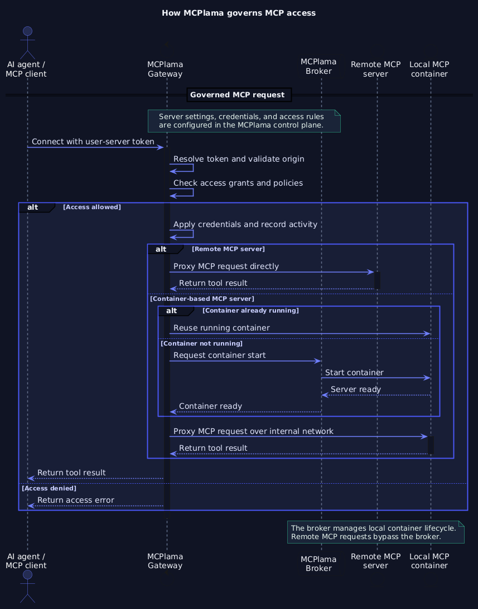
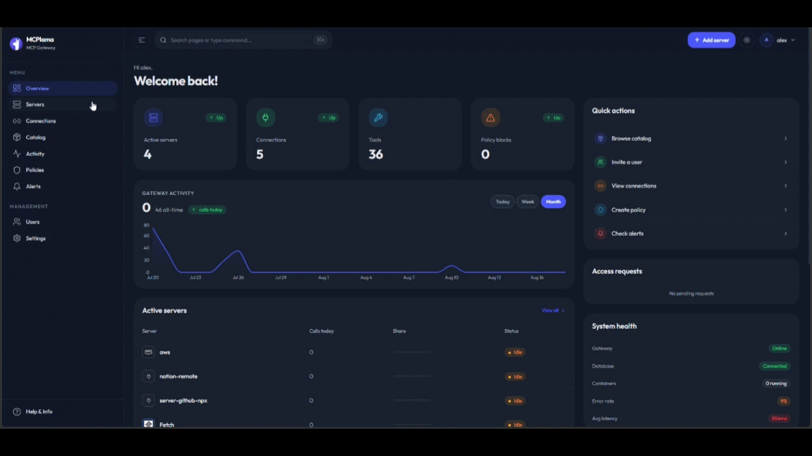

<h1 align="center">
  
  MCPlama
</h1>

<p align="center"><strong>Govern MCP access for AI agents and clients.</strong></p>
<p align="center">Open source · Self hosted · MCP gateway and control plane</p>

<p align="center">
  <a href="https://github.com/mcplama/mcplama/stargazers"></a>
  <a href="https://github.com/mcplama/mcplama/releases/latest"></a>
  <a href="https://github.com/mcplama/mcplama/blob/main/LICENSE"></a>
  <a href="https://hub.docker.com/r/mcplama/mcplama"></a>
</p>

MCPlama is an open-source, self-hosted **MCP gateway and governance platform**. It gives AI agents and MCP-compatible clients a controlled way to connect to local and remote Model Context Protocol (MCP) servers. Manage server connections, credentials, access policies, and activity from one place.

Instead of configuring every client with direct server access and credentials, register MCP servers in MCPlama and issue controlled connection URLs. MCPlama checks access and proxies requests to the selected server.



## Why use an MCP gateway?

As AI agents connect to more tools, it becomes harder to keep track of which agents can reach which servers and what credentials they use. Direct client-to-server configuration can scatter secrets and make access difficult to review or revoke.

MCPlama provides a central place to:

- Manage local and remote MCP servers
- Create controlled MCP connection URLs for compatible AI clients
- Store and manage OAuth and API credentials
- Set user and server access policies
- Review MCP activity and administrative audit events
- Explore users, connections, servers, tools, and permissions with Permission Map
- Manage MCP server catalog entries and server lifecycle

MCPlama can run locally for evaluation or as self-hosted infrastructure. MCP server containers are launched through a separate broker process in the recommended multi-container deployment.

## What you can do

### Connect AI agents to MCP servers

Configure a server once in MCPlama, then connect compatible clients through an MCPlama URL. User-specific connection tokens associate requests with an access grant while the underlying service credentials remain managed by MCPlama.

### Govern access

Manage users, groups, and server grants. Configure access policies and revoke access centrally. Permission Map provides a visual overview of configured users, connections, servers, tools, and supported access relationships.

### Manage credentials

Configure API credentials and OAuth for supported MCP servers. For remote OAuth servers, users can authorize their own provider accounts when that server's setup supports it. Provider tokens are used by MCPlama when proxying that user's requests.

### Review activity

Activity records MCP calls. Audit Logs records administrative changes such as server configuration, credential changes, invitations, user access, policies, and grants or revocations. Secret values are not recorded in audit entries.

## Quick start

Run MCPlama locally with Docker:

```bash
docker pull mcplama/mcplama:latest

docker run -d --name mcplama \
  -p 8080:8080 \
  -v mcplama-data:/var/lib/postgresql \
  -v /var/run/docker.sock:/var/run/docker.sock \
  mcplama/mcplama:latest
```

Open [http://localhost:8080](http://localhost:8080) and complete the setup wizard to create an administrator account. There is no default administrator account.

### Add an MCP server

1. Open **Catalog** and choose a preconfigured MCP server.
2. Select **Install**.
3. Open the server's **Authorization** tab and follow its setup steps.
4. Select **Authorize**.



### Connect an MCP client

Open the server's **Connect** tab and create a connection token. MCPlama provides a URL similar to:

```text
http://localhost:8000/connect/mcp_your_token
```

Use that URL in an MCP-compatible client. Each user and server pair gets its own connection token.

<details>
<summary><strong>Example: Claude Desktop</strong></summary>

```json
{
  "mcpServers": {
    "notion": {
      "url": "http://localhost:8000/connect/mcp_your_token"
    }
  }
}
```

</details>

<details>
<summary><strong>Example: VS Code</strong></summary>

Create `.vscode/mcp.json`:

```json
{
  "servers": {
    "notion": {
      "url": "http://localhost:8000/connect/mcp_your_token"
    }
  }
}
```

Requires VS Code 1.99+ with GitHub Copilot.

</details>

<details>
<summary><strong>Example: Cursor</strong></summary>

Add the URL to `~/.cursor/mcp.json`:

```json
{
  "mcpServers": {
    "notion": {
      "url": "http://localhost:8000/connect/mcp_your_token"
    }
  }
}
```

</details>

## How request governance works

When an AI client connects through MCPlama, the gateway:

1. Resolves the connection token to a user and MCP server.
2. Validates the request origin.
3. Checks access policies.
4. Uses the configured OAuth or API credentials.
5. Records the MCP activity and proxies the request to the server.

In the recommended multi-container deployment, a separate broker process starts MCP server containers. The broker is the only component with Docker socket access; the gateway and runner containers do not receive the Docker socket.

## Documentation

[](https://gitdiagram.com/mcplama/mcplama?utm_source=readme&utm_medium=picture)

- [Architecture](docs/ARCHITECTURE.md)
- [Security model](docs/SECURITY-MODEL.md)
- [Docker deployment](docs/DOCKER.md)
- [API reference](docs/API.md)
- [Registry and remote MCP OAuth](docs/REGISTRY.md)
- [Contributing](CONTRIBUTING.md)

## Production deployment

The quick start is intended for local evaluation. For production, configure deployment secrets and put an HTTPS reverse proxy in front of MCPlama. Review the [Docker deployment guide](docs/DOCKER.md) and [security model](docs/SECURITY-MODEL.md) before exposing an instance outside a trusted environment.

## Contributors

Thank you to everyone who helps make MCPlama better by reporting issues, contributing code, improving documentation, and sharing feedback.

- [mcplama](https://github.com/mcplama)
- [midoriyas90](https://github.com/midoriyas90)

Contributions of all kinds are welcome. Open an [issue](https://github.com/mcplama/mcplama/issues) or submit a [pull request](https://github.com/mcplama/mcplama/pulls).

## Contributing

Contributions, bug reports, and feedback are welcome. See the [contribution guidelines](CONTRIBUTING.md), [development setup](docs/DEVELOPMENT.md), and [registry request guide](docs/REGISTRY.md).

## License

MCPlama is licensed under the GNU Affero General Public License, version 3 or any later version. See [LICENSE](LICENSE). Third-party dependencies remain under their respective licenses; see [THIRD-PARTY-NOTICES](THIRD-PARTY-NOTICES).
